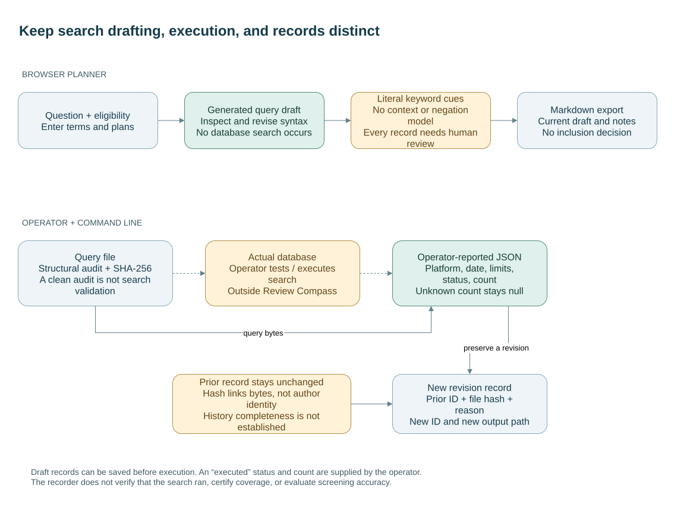

# From a draft to a search record

The browser planner and the command-line recorder support different steps. The planner holds proposed methods and literal keyword notes. The recorder preserves a query, its structural audit, and metadata supplied by an operator. Searching the database and assessing the evidence remain separate human tasks.



A record may stay a draft with an unknown (`null`) result count. When an operator reports execution, the supplied date, platform, limits, and count become a record of that report; the application does not verify them. Likewise, keyword cues leave every screened item marked **Needs human review**. A query with balanced delimiters may still be inappropriate for its database or research question.

The [example revision](../examples/search-revision.json) links to the previous record's ID and exact file fingerprint while preserving the earlier file. This supports inspection of a particular handoff. It does not establish who created the record, whether all revisions were retained, or whether the search ran. See the [practical-use contract](practical-use.md) and [search audit](search-audit.md).

The bundled search fixtures preserve exact bytes through Git checkout, including on Windows with automatic line-ending conversion enabled. Tests compare the audit, query/metadata fingerprints, and revision's predecessor fingerprint to those actual files. Both Linux and Windows CI run these checks; changing a fixture requires deliberately rebuilding its dependent examples.

## Edit and reproduce

The [draw.io source](diagrams/search-handoff.drawio) retains editable labels and connectors. To regenerate its committed SVG and PNG previews with draw.io Desktop:

```sh
python tools/export_workflow.py --drawio /path/to/draw.io
```

On Windows, supply the full quoted path to `draw.io.exe`. The script replaces only the two previews. The recorded rendering version is draw.io Desktop 32.6.1. This documentation change does not alter browser behavior, storage, exports, or query-audit rules; existing Node tests check those behaviors.
